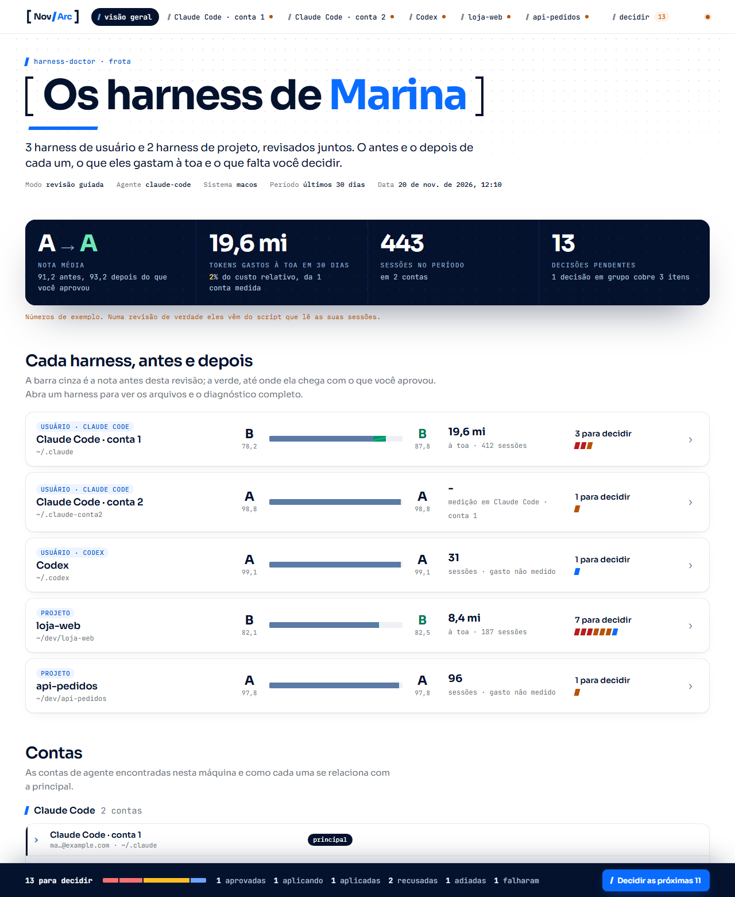
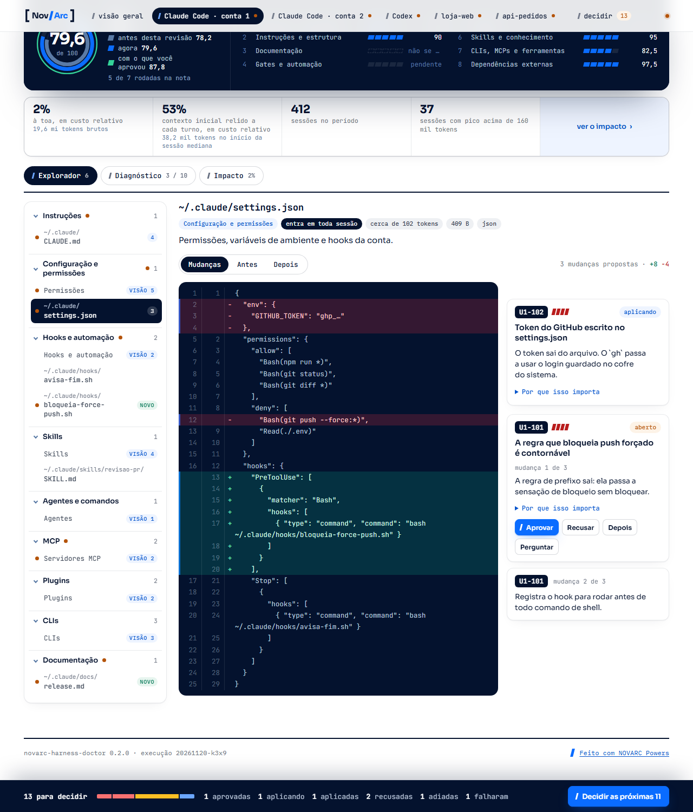

<div align="center">

# NOVARC Powers

**Skills that make your coding agent better at what it already does.**
For Claude Code, Codex and any agent that reads files and runs commands. macOS, Windows and Linux.

[](https://github.com/NovArc-Sistemas/novarc-powers/actions/workflows/validate.yml)
[](LICENSE)

**English** · [Português](README.md)

</div>

---

## novarc-harness-doctor

Your agent loads instructions, permissions, hooks, skills, plugins and MCP servers before you
type the first word. That is the **harness**, and it decides what every session costs and how
often the agent gets things wrong. harness-doctor finds every harness on your machine (one per
account, one per project), measures what they cost over the last 30 days, and shows on a single
board what is wrong, why, and exactly what changes.

<p align="center">
  
</p>

- **Measured on your data.** It reads the last 30 days of sessions, on your machine only, and
  counts the tokens that went into commands repeated after failing, work redone after you
  corrected the agent, blind exploration and context loaded but never used. Measured and
  estimated numbers are never mixed.
- **It teaches while it diagnoses.** Every finding comes with the why, the cost, the rule to
  keep, and the change drawn inside the file itself: what goes in red, what arrives in green.
- **It is an explorer of your harness.** Each account and each project is a tab: instructions,
  permissions, hooks, support scripts, gates, skills, MCP servers and CLIs, all browsable.
- **You decide, it applies.** Approve, decline or defer with a click. Every change is backed
  up and can be undone with one command.
- **It keeps your accounts in step.** Pick one account as the primary; the others of the same
  provider link to it, and other providers get the part that can be replicated.
- **It comes back to check.** Every review is recorded: what was decided, what changed and what
  each change promised to save. A month later the same skill measures again, shows what was
  confirmed, what was undone and what came back, and reviews each harness again.

<p align="center">
  
</p>

### Use it now, without installing anything

Paste this into your agent:

> Run `npx -y github:NovArc-Sistemas/novarc-powers fetch novarc-harness-doctor`, read the SKILL.md
> at the path it prints and follow it to review my harnesses.

It needs Node 20 or newer and git. Nothing leaves your machine unless you choose to publish the
board as a private page on claude.ai.

Details: [skills/novarc-harness-doctor](skills/novarc-harness-doctor).

## Installer

```bash
npx github:NovArc-Sistemas/novarc-powers
```

The installer detects your agents, groups the skills by the profile we recommend for each, and
lists every file it will create or change before asking you to confirm.

```bash
npx github:NovArc-Sistemas/novarc-powers list          # catalog with recommended profiles
npx github:NovArc-Sistemas/novarc-powers add <skill>   # one skill, no menu
npx github:NovArc-Sistemas/novarc-powers status        # what is installed, where, which version
npx github:NovArc-Sistemas/novarc-powers update        # shows what changes, applies after you confirm
npx github:NovArc-Sistemas/novarc-powers remove <skill>
```

All accept `--yes`, `--scope user|project|both`, `--skills a,b`, `--dry-run` and `--json`, so
an agent or a script can run them without a menu.

## Catalog

| Skill | What it does | Recommended profile | Agents |
|---|---|---|---|
| [**novarc-harness-doctor**](skills/novarc-harness-doctor) | Finds, measures, explains and fixes your agents' harnesses: one review for every account and project, on an interactive board. | On-demand | Claude Code · Codex · OpenCode · Cursor |

More skills are coming. Follow the [CHANGELOG](CHANGELOG.md).

## Install profiles

Every skill ships with the profile we recommend. You can change it at install time.

| Profile | For | What the installer does | Cost in every session |
|---|---|---|---|
| **On-demand** | Rare tasks with a start and an end | Writes a short block in `CLAUDE.md` / `AGENTS.md` telling the agent how to fetch the skill when needed | A few lines |
| **User harness** | Your habits, in every project | Copies the skill to `~/.claude/skills`, `~/.codex/skills` or `~/.agents/skills` | The skill description |
| **Project harness** | The team's process, versioned with the code | Copies the skill to the project's `.claude/skills` or `.agents/skills` | The description, in that project only |

Details in [docs/profiles.md](docs/profiles.md).

## Updates

At install time you choose: **notify** (recommended), apply automatically, or off. A skill is
text your agent obeys with your permissions; reading what changed before applying it costs one
command.

## Where skills keep their files

Every skill uses a single `.novarc-powers/` folder, in your home or in the project, with one
subfolder per skill. Removing a skill keeps its data unless you pass `--purge`.

## Guarantees

No skill here does any of the following without your confirmation: install software, delete
files, change permissions, touch secrets, add a gate, link accounts, commit, push or publish
anything. Secrets are never printed, and every edit is backed up first.

## Share a single skill

Each folder in [`skills/`](skills) is self-contained with its own README: to share a skill,
send the folder link. In Claude Code you can also use the plugin marketplace, one skill per
plugin:

```text
/plugin marketplace add NovArc-Sistemas/novarc-powers
/plugin install novarc-harness-doctor@novarc-powers
```

## Contributing

Ideas and fixes are welcome. Read [CONTRIBUTING.md](CONTRIBUTING.md) and the pattern for a new
skill in [docs/authoring.md](docs/authoring.md).

## Credits

harness-doctor's rule engine and its weighted score were inspired by
[AgentShield](https://github.com/affaan-m/agentshield) (MIT). Tool recommendations cite their
source in [`references/catalog`](skills/novarc-harness-doctor/references/catalog).

## License

[MIT](LICENSE) © NOVARC Sistemas
