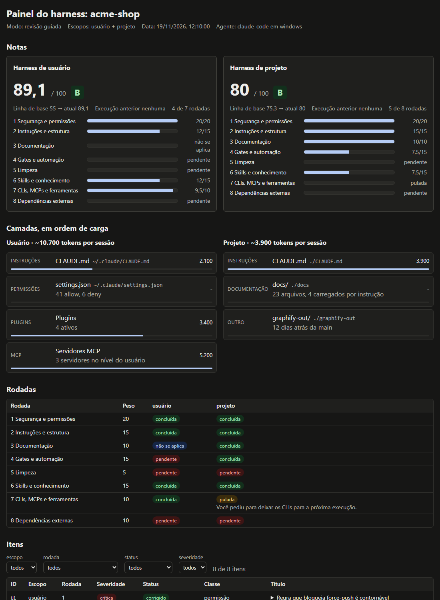

<div align="center">

# NOVARC Powers

**Skills que deixam o seu agente de código melhor no que já faz.**
Para Claude Code, Codex e qualquer agente que lê arquivos e roda comandos. macOS, Windows e Linux.

[](https://www.npmjs.com/package/novarc-powers)
[](https://github.com/NovArc-Sistemas/novarc-powers/actions/workflows/validate.yml)
[](LICENSE)

[English](README.en.md) · **Português**

</div>

---

<p align="center">
  
</p>

## Comece em 30 segundos

```bash
npx novarc-powers
```

O instalador detecta seus agentes, mostra as skills agrupadas pelo perfil que recomendamos para
cada uma, e lista cada arquivo que vai criar ou alterar antes de pedir confirmação.

Não quer instalar nada? Cole isto no seu agente:

> Rode `npx -y novarc-powers fetch novarc-harness-doctor`, leia o SKILL.md no caminho que ele
> imprimir e siga as instruções para revisar meu harness.

## Catálogo

| Skill | O que faz | Perfil recomendado | Agentes |
|---|---|---|---|
| [**novarc-harness-doctor**](skills/novarc-harness-doctor) | Inventaria, dá nota e corrige o harness do seu agente: instruções, permissões, hooks, skills, plugins, MCPs (CLI antes de MCP), CLIs, recursos ocultos, documentação e gates. Modo guiado ou automático. | Execução pontual | Claude Code · Codex · Traycer |

Mais skills chegando. Acompanhe o [CHANGELOG](CHANGELOG.md).

## Perfis de instalação

Cada skill vem com o perfil que recomendamos. Você pode trocar na instalação.

| Perfil | Para quê | O que o instalador faz | Custo em toda sessão |
|---|---|---|---|
| **Execução pontual** | Tarefa rara, com começo e fim | Grava só uma linha no `CLAUDE.md` / `AGENTS.md` dizendo como buscar a skill quando precisar | Uma linha |
| **Harness de usuário** | Hábito seu, em todo projeto | Copia a skill para `~/.claude/skills`, `~/.codex/skills` ou `~/.agents/skills` | A descrição da skill |
| **Harness de projeto** | Processo do time, versionado com o código | Copia a skill para `.claude/skills` ou `.agents/skills` do projeto | A descrição, só naquele projeto |

Detalhes em [docs/profiles.md](docs/profiles.md).

## Comandos

```bash
npx novarc-powers               # instalação interativa
npx novarc-powers list          # catálogo com o perfil recomendado
npx novarc-powers add <skill>   # uma skill, sem menu
npx novarc-powers status        # o que está instalado, onde e em que versão
npx novarc-powers update        # mostra o que muda e aplica após confirmar
npx novarc-powers remove <skill>
```

Todos aceitam `--yes`, `--scope user|project|both`, `--skills a,b`, `--dry-run` e `--json`,
para rodar sem menu (por exemplo, por um agente ou num script).

## Atualizações

Na instalação você escolhe:

- **Avisar** (recomendado): uma linha no início da sessão quando há versão nova; você roda
  `npx novarc-powers update`, que mostra o que muda antes de aplicar.
- **Aplicar sozinho**: a atualização entra sem você revisar.
- **Desligado**.

Recomendamos avisar. Uma skill é um texto que o agente obedece com as suas permissões; ler o
que mudou antes de aplicar custa um comando.

## Onde as skills guardam seus arquivos

Toda skill que precisa de arquivos de trabalho usa uma pasta só, `.novarc-powers/`, no projeto
ou na sua home, com uma subpasta por skill:

```text
.novarc-powers/
├── manifest.json              # o que o instalador instalou
└── novarc-harness-doctor/     # cada skill mexe só na própria pasta
    ├── state.json
    ├── reports/
    ├── backups/               # nunca vai para o git
    └── logs/                  # nunca vai para o git
```

Desinstalar uma skill não apaga os dados dela, a menos que você peça `--purge`.

## Garantias

Nenhuma skill daqui faz sem a sua confirmação:

- instalar software;
- apagar arquivos;
- mudar permissões;
- mexer em segredos;
- fazer commit, push ou publicar qualquer coisa.

Segredos nunca são impressos, e toda edição tem backup antes.

## Compartilhe uma skill só

Cada pasta em [`skills/`](skills) é autocontida e tem README próprio. Para mandar uma skill
para alguém, mande o link da pasta. Para instalar só ela:

```bash
npx novarc-powers add novarc-harness-doctor
```

No Claude Code, também dá para usar o marketplace de plugins, uma skill por plugin:

```text
/plugin marketplace add NovArc-Sistemas/novarc-powers
/plugin install novarc-harness-doctor@novarc-powers
```

## Contribua

Ideias e correções são bem-vindas. Leia [CONTRIBUTING.md](CONTRIBUTING.md) e o padrão para
uma skill nova em [docs/authoring.md](docs/authoring.md).

## Licença

[MIT](LICENSE) © NOVARC Sistemas
