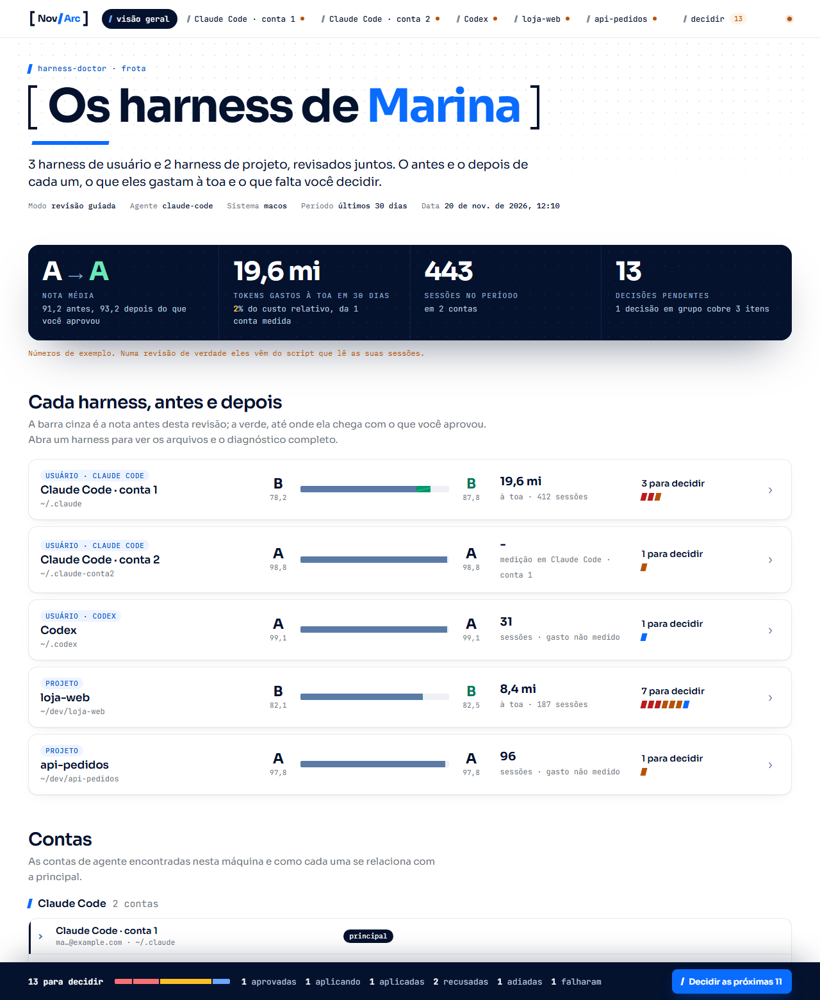
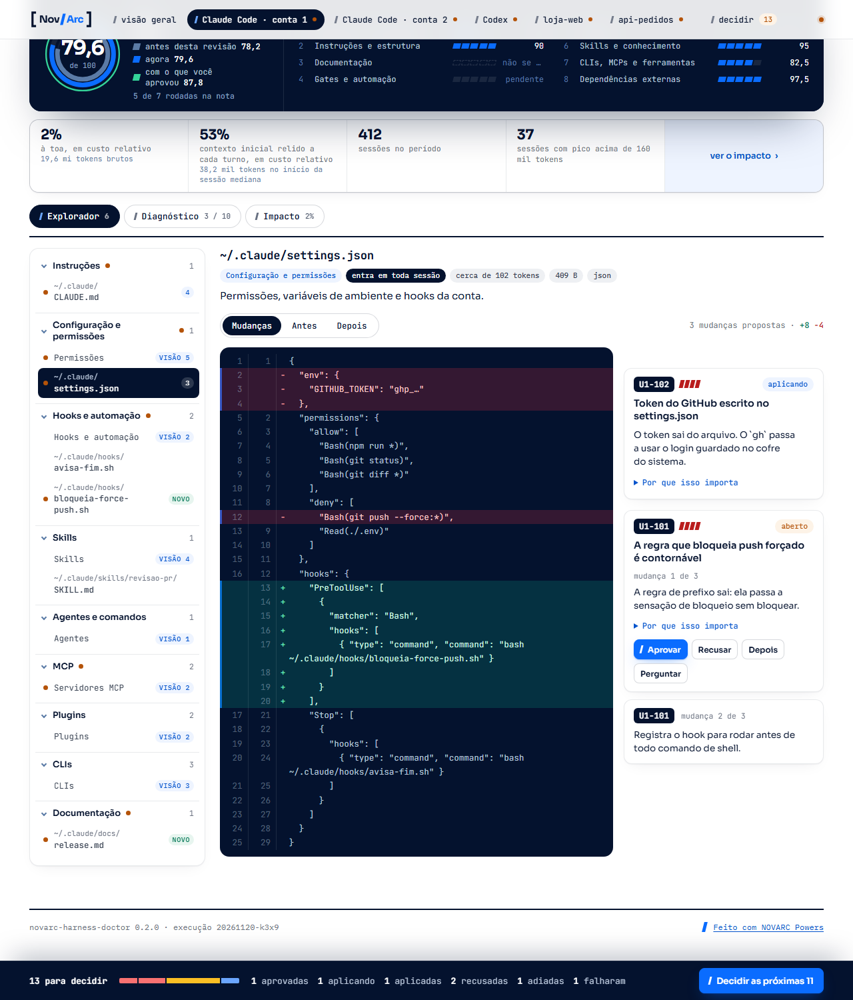

# novarc-harness-doctor

[Português](README.md) · **English** · Part of [NovArc Powers](https://github.com/NovArc-Sistemas/novarc-powers/blob/main/README.en.md)

Finds every agent harness on your machine, measures what it cost over the last 30 days, explains
what is wrong and fixes what you approve, on an interactive board.

The **harness** is everything that shapes a session before you type: instruction files,
permissions, hooks, skills, plugins, MCP servers, CLIs, the project's docs, and the gates that
stop mistakes. You have one user harness **per account** (each Claude Code account, Codex, and
so on) and one project harness **per repository**.

<p align="center">
  
</p>

- **Measured on your data.** It reads the last 30 days of sessions, on your machine only, and
  counts the tokens that went into commands repeated after failing, work redone after you
  corrected the agent, blind exploration and context loaded but never used. Measured and
  estimated numbers are never mixed.
- **It teaches while it diagnoses.** Every finding comes with the why, the cost, the rule to
  keep, and the change drawn inside the file itself: what goes in red, what arrives in green.
- **It is an explorer of your harness.** Each account and each project is a tab: instructions,
  permissions, hooks, support scripts, gates, skills, MCP servers and CLIs, all browsable.
- **You decide in conversation, it applies.** The board is for looking; you decide in the
  conversation with the agent. Every change is backed up and can be undone with one command.
- **It keeps your accounts in step.** Pick one account as the primary; the others of the same
  provider link to it, and other providers get the part that can be replicated.
- **It comes back to check.** Every review is recorded. A month later the same skill measures
  again, shows what was confirmed, what was undone and what came back, and reviews each
  harness again.

<p align="center">
  
</p>

## How to use it

Without installing anything, ask your agent:

> Run `npx -y novarc-powers fetch novarc-harness-doctor`, read the SKILL.md at the path it
> prints and follow it to review my harnesses.

Or install the pointer with `npx novarc-powers add novarc-harness-doctor`, then just ask
"review my harnesses" in any session. It needs Node 20+ and git. Nothing leaves your machine
unless you choose to publish the board as a private page on claude.ai.

## What happens

1. **Find.** It lists the agent accounts on the machine and the git repositories with agent
   activity. You choose what enters the review and, with more than one account, which is the
   primary.
2. **Measure.** It reads the last 30 days of sessions, on your machine only, and returns
   numbers only: tokens in the period, context loaded before you type, commands repeated after
   failing, work redone after a correction, exploration before the first edit, skills and MCP
   servers loaded and never used.
3. **Review in eight rounds**: security and permissions; instructions and structure;
   documentation; gates and automation; cleanup; skills and knowledge; CLIs, MCP servers and
   tools; external dependencies. A rule engine raises candidates; the agent confirms each one
   in the real file before it becomes a finding.
4. **Show the board**, with one tab per harness.
5. **Apply what you approve**, with a backup, verification after the change and a record of
   what could not be verified. `run.mjs undo` reverts one item or the whole review.
6. **Record, and come back to check.** On close, each harness gets a record of the review: what
   was decided, what changed, what each change promised to save, and the measurements of the
   day. Ask for the review again a month later: it measures the period since, says per
   measurement whether the expected effect was confirmed, checks on disk that each fix is still
   in place, shows what came back, and reviews the harness again. What you declined is not
   proposed again without a reason.

## The board

- **Overview:** the before and after score of every harness, what the fleet spent on measured
  inefficiencies, the accounts found, and the decisions that cover several harnesses at once.
- **One tab per harness**, in three parts:
  - **Impact:** where the tokens went over the last 30 days, with measured apart from estimated.
  - **Explorer:** the harness files (instructions, settings and permissions, hooks, support
    scripts, project gates, skills, MCP servers, CLIs, docs). Open a file and see every
    proposed change in place: what goes in red, what arrives in green, and the why beside it.
    Switch between changes, before and after.
  - **Diagnosis:** each finding with why it is a problem, what it costs, how it gets better and
    the rule to keep.
- **Pending:** what waits for your decision, with each item's id. You decide in the
  conversation with the agent ("approve ACME-104", "why U1-202?"): the board only shows.

The board opens as a private page on claude.ai (if you use Claude Code and agree) or as a local
page on `127.0.0.1`. The content is the same.

## Accounts

If the machine has more than one account, each gets its own tab and you choose one as the
primary. The other accounts of the same provider then point at the primary's files; other
providers get what can be replicated (instructions, skills, MCP servers), and the board says
what is not portable and why. A check at session start keeps everything in step and never
overwrites a file you edited by hand. Credentials and sessions are never touched.

## The two modes

| | Guided review | Doctor |
|---|---|---|
| Reversible fixes with backup | you decide | applied, shown afterwards |
| Additions (missing rule, skills index) | you decide | applied, shown afterwards |
| Turning on an opt-in feature confirmed for your version | you decide | applied and checked |
| Translating agent files to English | you decide | drafted for your approval |
| Permissions, secrets, deletions, installs, gates, MCP servers, accounts | you decide | you decide |

## What it recommends

Only what was verified at the source, with a date:

- **CLI before MCP.** An MCP server stays at user level only if nearly every session uses it
  and it does something a CLI cannot. The rest moves to the project or becomes a CLI, with the
  login guided without asking for a token in chat.
- **Agent-facing files in English**, which cost fewer tokens.
- **Gates** built from the failures you actually had, weighed by what they cost.
- **Superpowers** and a short skills index; **Graphify** for code projects, checking that the
  graph stays fresh without slowing work; **rtk**, **caveman** and **ponytail**, with a note on
  where they overlap.
- **Hidden features** of your agent, confirmed for the installed version.

## Privacy

Everything runs on your machine. Reading sessions returns counts only, never conversation
text. Secrets show only their first 4 characters. The board contains the text of the harness
files (secrets masked); it goes to claude.ai only if you ask.

## Where files live

```text
~/.novarc-powers/novarc-harness-doctor/
├── runs/<id>/     # one folder per review: measurements, findings, decisions, backups, board
├── history/       # one record per harness and review, which the next review compares against
├── sync/          # record and check of linked accounts
└── latest.json
```

## Credits

The rule engine and the scoring model were inspired by
[AgentShield](https://github.com/affaan-m/agentshield) (MIT), re-implemented here.
