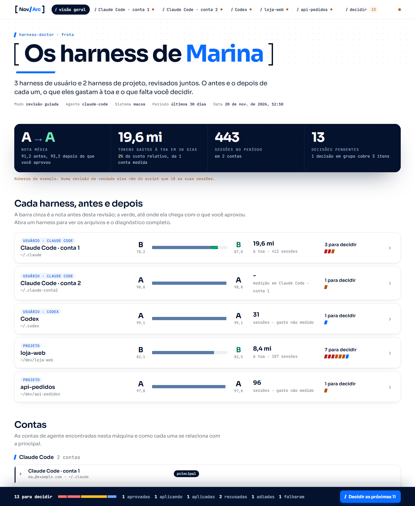
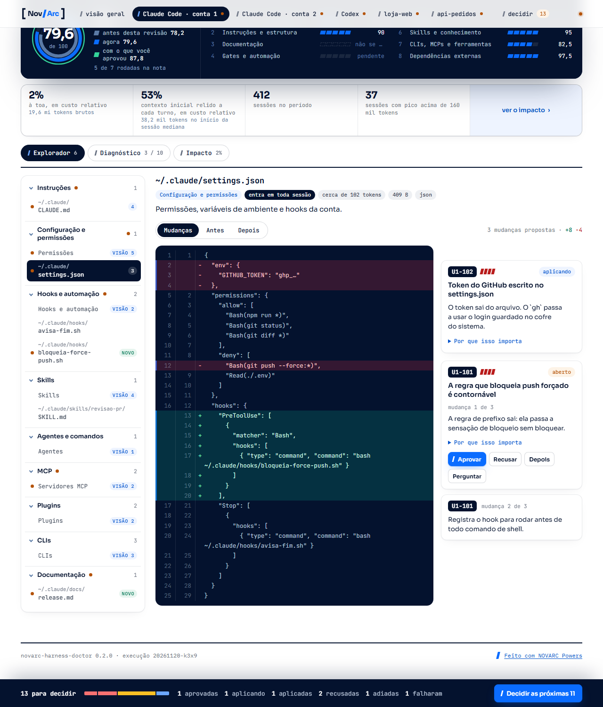

# novarc-harness-doctor

**Português** · [English](README.en.md) · Parte do [NovArc Powers](https://github.com/NovArc-Sistemas/novarc-powers)

Encontra todos os harness de agente da sua máquina, mede o que custaram nos últimos 30 dias,
explica o que está errado e corrige o que você aprovar, num painel interativo.

O **harness** é tudo o que molda uma sessão antes de você digitar: arquivos de instrução,
permissões, hooks, skills, plugins, servidores MCP, CLIs, a documentação do projeto e os gates
que impedem erros. Você tem um harness de usuário **por conta** (cada conta do Claude Code, o
Codex, e assim por diante) e um harness de projeto **por repositório**.

<p align="center">
  
</p>

- **Mede com os seus dados.** Lê as sessões dos últimos 30 dias, só na sua máquina, e conta os
  tokens que foram para comando repetido depois de falhar, trabalho refeito depois de uma
  correção sua, exploração às cegas e contexto carregado sem uso. Medido e estimado nunca se
  misturam.
- **Ensina enquanto diagnostica.** Cada achado vem com o porquê, o custo, a regra para levar e a
  mudança desenhada dentro do próprio arquivo: o que sai em vermelho, o que entra em verde.
- **É um explorador do seu harness.** Cada conta e cada projeto vira uma aba: instruções,
  permissões, hooks, scripts de apoio, gates, skills, MCPs e CLIs, tudo navegável.
- **Você decide conversando, ele aplica.** O painel é para ver; as decisões você toma na
  conversa com o agente. Toda mudança tem backup e pode ser desfeita com um comando.
- **Mantém suas contas iguais.** Escolha uma conta como principal; as outras do mesmo provedor
  passam a apontar para ela, e as de outros provedores recebem a parte que dá para replicar.
- **Volta para conferir.** Cada revisão fica registrada. Um mês depois, a mesma skill mede de
  novo, mostra o que se confirmou, o que foi desfeito e o que voltou, e reavalia cada harness.

<p align="center">
  
</p>

## Como usar

Sem instalar nada, peça ao seu agente:

> Rode `npx -y novarc-powers fetch novarc-harness-doctor`, leia o SKILL.md no caminho que ele
> imprimir e siga as instruções para revisar os meus harness.

Ou instale o ponteiro com `npx novarc-powers add novarc-harness-doctor`. Depois basta pedir
"revisa meus harness" em qualquer sessão. Precisa de Node 20+ e git. Nada sai da sua máquina, a
menos que você escolha publicar o painel como uma página privada no claude.ai.

## O que acontece

1. **Encontra.** Lista as contas de agente da máquina e os repositórios git com atividade de
   agente. Você escolhe o que entra na revisão e, se tiver mais de uma conta, qual é a
   principal.
2. **Mede.** Lê as sessões dos últimos 30 dias, só na sua máquina, e devolve apenas números:
   tokens no período, contexto carregado antes de você digitar, comandos repetidos depois de
   falhar, trabalho refeito depois de uma correção, exploração antes da primeira edição, skills
   e servidores MCP carregados e nunca usados.
3. **Revisa em oito rodadas**: segurança e permissões; instruções e estrutura; documentação;
   gates e automação; limpeza; skills e conhecimento; CLIs, MCPs e ferramentas; dependências
   externas. Um motor de regras levanta os candidatos; o agente confirma cada um no arquivo
   real antes de virar achado.
4. **Mostra o painel**, com uma aba por harness.
5. **Aplica o que você aprovar**, com backup, verificação depois da mudança e registro do que
   não deu para verificar. `run.mjs undo` desfaz um item ou a revisão inteira.
6. **Registra e volta para conferir.** Ao fechar, cada harness ganha um registro da revisão: o
   que foi decidido, o que mudou, quanto cada mudança prometia economizar e as medições do dia.
   Peça a revisão de novo depois de um mês: ela mede o período desde então, diz por medida se
   o efeito esperado se confirmou, confere no disco se cada correção continua no lugar, mostra
   o que voltou e reavalia o harness. O que você recusou não é proposto de novo sem motivo.

## O painel

- **Visão geral:** a nota de antes e de depois de cada harness, o que a frota gastou em
  ineficiências medidas, as contas encontradas e as decisões que valem para vários harness de
  uma vez.
- **Uma aba por harness**, com três partes:
  - **Impacto:** para onde foram os tokens nos últimos 30 dias, com o medido separado do
    estimado.
  - **Explorador:** os arquivos do harness (instruções, configuração e permissões, hooks,
    scripts de apoio, gates do projeto, skills, MCPs, CLIs, documentação). Abra um arquivo e
    veja cada mudança proposta no lugar: o que sai em vermelho, o que entra em verde, e ao lado
    o porquê. Alterne entre mudanças, antes e depois.
  - **Diagnóstico:** cada achado com o porquê é um problema, o que custa, como fica melhor e a
    regra para levar.
- **Pendências:** o que espera a sua decisão, com o código de cada item. A decisão em si você
  toma na conversa com o agente ("aprova ACME-104", "por que U1-202?"): o painel só mostra.

O painel abre como página privada no claude.ai (se você usa Claude Code e autorizar) ou como
página local em `127.0.0.1`. O conteúdo é o mesmo.

## Contas

Se a máquina tem mais de uma conta, cada uma ganha sua aba, e você escolhe uma como principal.
As outras contas do mesmo provedor passam a apontar para os arquivos da principal; as de outros
provedores recebem o que dá para replicar (instruções, skills, servidores MCP), e o painel diz
o que não é portável e por quê. Uma checagem no início da sessão mantém tudo em dia e nunca
sobrescreve um arquivo que você editou à mão. Credenciais e sessões nunca são tocadas.

## Os dois modos

| | Revisão guiada | Doctor |
|---|---|---|
| Correções reversíveis com backup | você decide | aplica e mostra depois |
| Acréscimos (regra que falta, índice de skills) | você decide | aplica e mostra depois |
| Ligar recurso opcional confirmado para a sua versão | você decide | aplica e testa |
| Tradução de arquivos de agente para inglês | você decide | deixa pronta para você aprovar |
| Permissões, segredos, exclusões, instalações, gates, MCPs, contas | você decide | você decide |

## O que ela recomenda

Só o que foi verificado na fonte, com data:

- **CLI antes de MCP.** Um servidor MCP só fica no nível do usuário se quase toda sessão o usa
  e se ele faz algo que um CLI não faz. O resto vai para o projeto ou vira CLI, com o login
  guiado sem pedir token no chat.
- **Arquivos para agentes em inglês**, que custam menos tokens.
- **Gates** a partir das falhas que você teve de fato, pesados pelo que custaram.
- **Superpowers** e um índice curto de skills; **Graphify** em projetos de código, conferindo
  se o grafo se mantém atualizado sem atrasar o trabalho; **rtk**, **caveman** e **ponytail**,
  avisando onde se sobrepõem.
- **Recursos ocultos** do seu agente, confirmados para a versão instalada.

## Privacidade

Tudo roda na sua máquina. A leitura das sessões devolve apenas contagens, nunca o texto das
conversas. Segredos aparecem só com os 4 primeiros caracteres. O painel contém o texto dos
arquivos do harness (com segredos mascarados); ele só vai para o claude.ai se você pedir.

## Onde ficam os arquivos

```text
~/.novarc-powers/novarc-harness-doctor/
├── runs/<id>/     # uma pasta por revisão: medições, achados, decisões, backups, painel
├── history/       # um registro por harness e por revisão, que a próxima revisão compara
├── sync/          # registro e checagem das contas ligadas
└── latest.json
```

## Créditos

O motor de regras e o modelo de nota foram inspirados no
[AgentShield](https://github.com/affaan-m/agentshield) (MIT), reescritos aqui.
